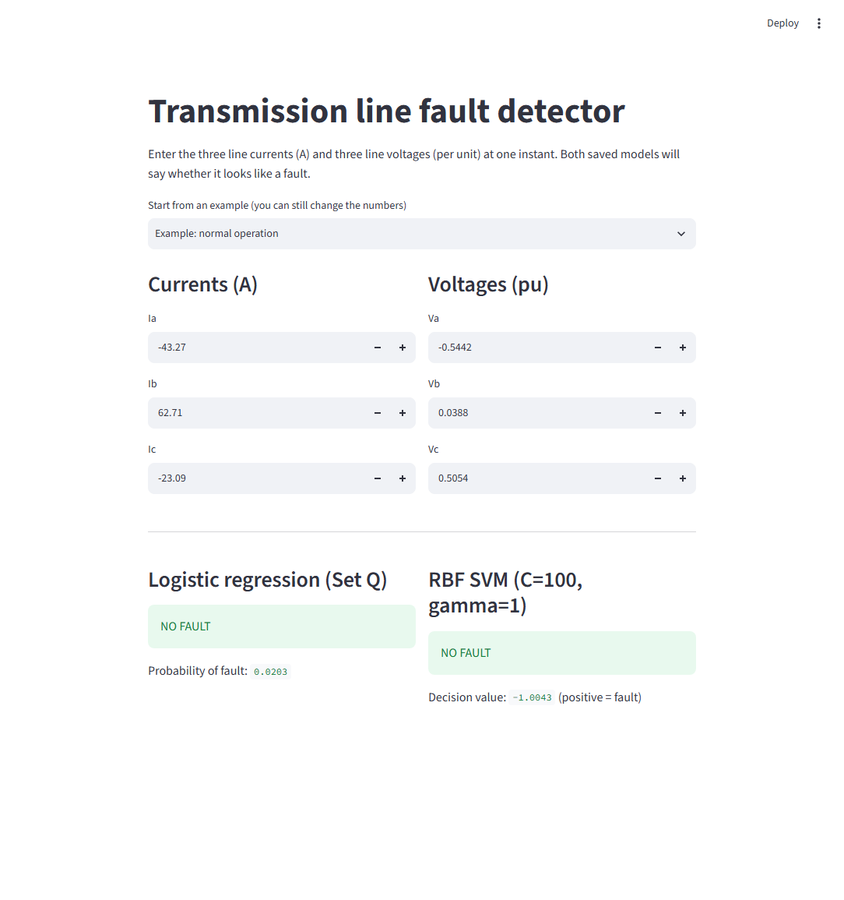
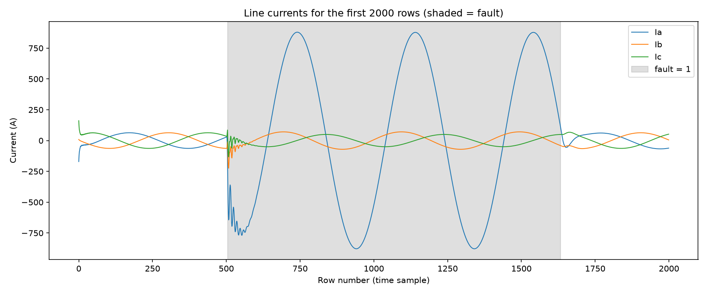
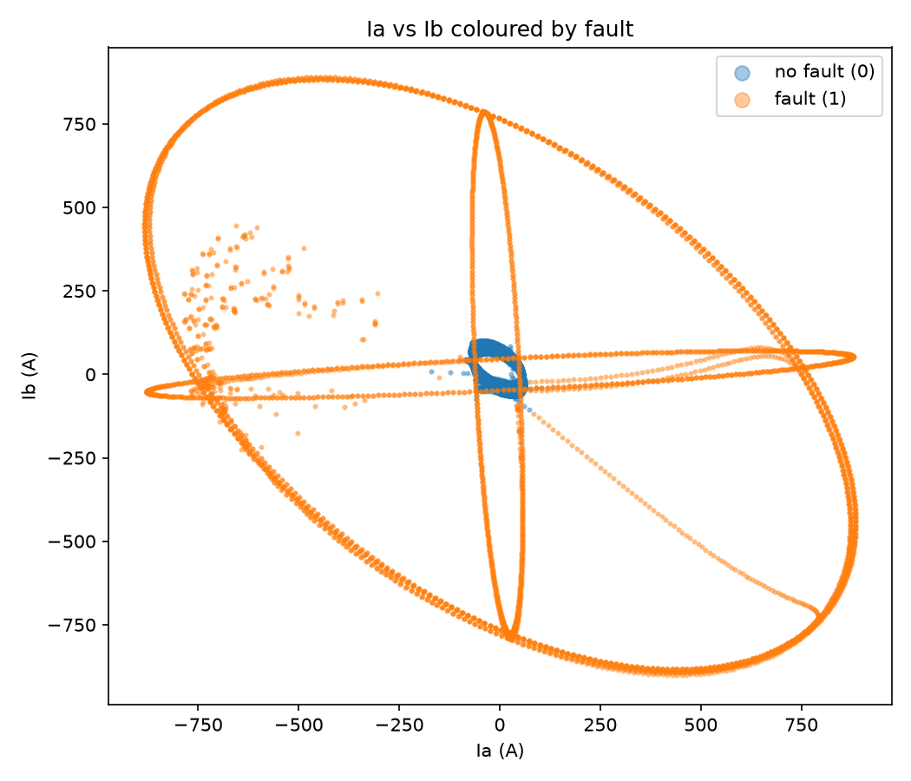
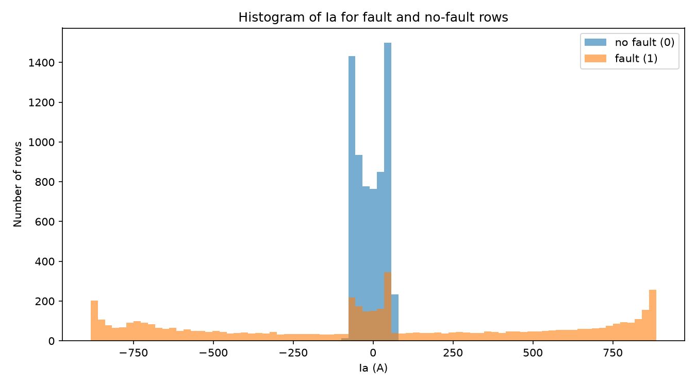
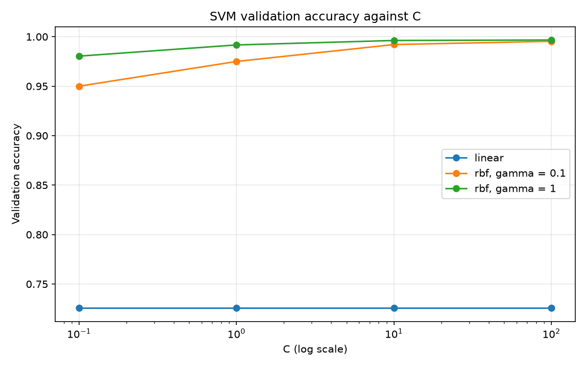
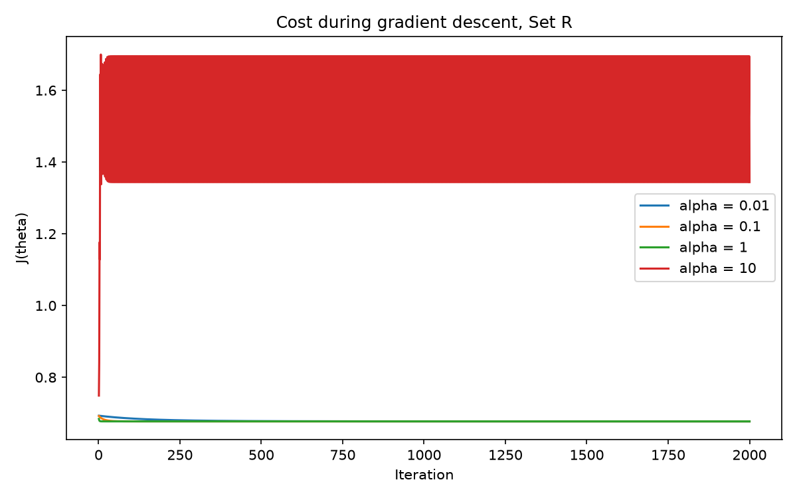
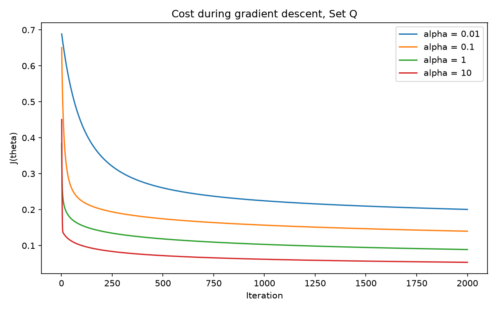

# Detecting Faults on a Three-Phase Transmission Line

Applied Machine Learning – Assignment 2

We build a classifier that looks at **one instant** of the three line currents (Ia, Ib, Ic) and three line voltages (Va, Vb, Vc) and decides whether the line has a **fault** (1) or **no fault** (0).

**The question:** can a straight-line decision boundary detect a fault from raw instantaneous measurements? If not, what is the simplest fix: changing the features, or changing the classifier?

**Our answer:** no. A straight line only reaches about 73% test accuracy and misses more than 600 faults. Both fixes work:
- adding squared features (Set Q) lifts logistic regression to **97.9%**,
- switching to an RBF-kernel SVM gives **99.6%**, with only 6 missed faults.

- Medium blog: https://medium.com/@moomaleman41/can-a-straight-line-catch-a-short-circuit-86ae15422301
- LinkedIn post: https://www.linkedin.com/posts/tayyba-bashir-77983a332_machinelearning-powersystems-logisticregression-activity-7515120378093056001-CZYz?utm_source=share&utm_medium=member_android&rcm=ACoAAFPF-s0BVs--QV17JpZbd6ltzhDypxuImbM

## Dataset

[Electrical Fault Detection and Classification](https://www.kaggle.com/datasets/esathyaprakash/electrical-fault-detection-and-classification) (Kaggle). We only use `detect_dataset.csv` (12,001 rows), and it is already included in `data/`.

## Rules we followed

- Logistic regression is written from scratch with NumPy (`src/logistic.py`).
- From scikit-learn we only use `sklearn.svm.SVC`.
- Splitting, standardising, accuracy and the confusion matrix are all our own code.

## Project layout

```
data/
  detect_dataset.csv          original data from Kaggle
  clean_dataset.csv           made by prepare.py (cleaned raw values + split column)
  standardised_dataset.csv    made by prepare.py (6 standardised features + split column)
src/
  load_data.py                the loader given in the assignment
  prepare.py                  Task 1: cleaning, split, standardisation
  eda.py                      Task 2: exploratory plots
  logistic.py                 sigmoid, hypothesis, cost, fit_logistic, predict
  metrics.py                  accuracy, confusion_matrix
  train_logistic.py           Task 3: choose alpha, train Set R and Set Q
  train_svm.py                Task 4: linear and RBF SVMs
  test_models.py              Task 5: evaluate the 4 final models on the test set once
results/
  tables/                     Tables 1-5 as CSV files
  figures/                    all plots + app screenshot
  eda_notes.md                explanations of the Task 2 plots
  analysis.md                 Task 6 answers
  theta_setR.csv, theta_setQ.csv              learned logistic regression weights
  svm_linear_best.joblib, svm_rbf_best.joblib saved SVM models
  scaling_stats.csv, scaling_stats_setQ.csv   training mean/std (used by the app)
app/
  app.py                      Task 7: Streamlit front end
```

## How to run

Run every command from the **project folder** (the one with `data/`, `src/` and `app/`), not from inside `src/`.

**1. Install the libraries** (Python 3.10 or newer)
```
pip install -r requirements.txt
```

**2. Run the scripts in this order**
```
python src/prepare.py          # Task 1  - cleans, splits and standardises, writes Table 1
python src/eda.py              # Task 2  - three exploratory plots
python src/train_logistic.py   # Task 3  - alpha search + final logistic models, Tables 2 and 5
python src/train_svm.py        # Task 4  - 12 SVMs, Table 3 (takes about 1-2 minutes)
python src/test_models.py      # Task 5  - test results, Table 4
```
Each script prints its results and saves its tables and figures to `results/`. The saved models are already in the repo, so you can also skip straight to step 3.

**3. Start the web app**
```
streamlit run app/app.py
```
It opens in your browser at http://localhost:8501. Pick an example or type in your own six values, and the app shows the prediction of the saved Set-Q logistic regression and the saved RBF SVM side by side.



## Results

### Data preparation (Table 1)

| | |
|---|---|
| Raw rows / columns | 12001 / 9 |
| Columns removed | Unnamed: 7, Unnamed: 8 (completely empty) |
| Missing values after cleaning | 0 |
| Fault / no-fault rows | 5496 / 6505 |
| Train / validation / test rows | 7200 / 2400 / 2401 |
| Fault fraction train / val / test | 0.461 / 0.451 / 0.456 |

### Logistic regression (Table 2)

| Feature set | Chosen α | Final J(θ) | Validation accuracy |
|---|---|---|---|
| Set R (6 raw features) | 1 | 0.6772 | 73.08% |
| Set Q (raw + squares, 12 features) | 10 | 0.0534 | 97.83% |

### SVM validation (Table 3)

| Kernel | C | γ | Validation accuracy | Support vectors |
|---|---|---|---|---|
| linear | 0.1 | – | 72.58% | 5846 |
| linear | 1 | – | 72.58% | 5838 |
| linear | 10 | – | 72.58% | 5836 |
| linear | 100 | – | 72.58% | 5837 |
| rbf | 0.1 | 0.1 | 95.00% | 1348 |
| rbf | 0.1 | 1 | 98.04% | 867 |
| rbf | 1 | 0.1 | 97.50% | 723 |
| rbf | 1 | 1 | 99.17% | 501 |
| rbf | 10 | 0.1 | 99.21% | 381 |
| rbf | 10 | 1 | 99.62% | 336 |
| rbf | 100 | 0.1 | 99.54% | 174 |
| rbf | 100 | 1 | **99.67%** | 278 |

All four linear SVMs tie, so we keep the first one (C = 0.1).

### Test results (Table 4)

| Model | Accuracy | TN | False alarms | Missed faults | TP |
|---|---|---|---|---|---|
| Logistic regression, Set R | 72.64% | 1305 | 0 | 657 | 439 |
| Logistic regression, Set Q | 97.88% | 1299 | 6 | 45 | 1051 |
| Linear SVM (C=0.1) | 73.59% | 1305 | 0 | 634 | 462 |
| RBF SVM (C=100, γ=1) | **99.58%** | 1301 | 4 | **6** | 1090 |

### Learned θ for Set Q (Table 5)

| Weight | Value | | Weight | Value |
|---|---|---|---|---|
| θ0 (intercept) | 24.9209 | | | |
| Ia | 2.3273 | | Ia² | 18.8912 |
| Ib | -5.3581 | | Ib² | 4.7543 |
| Ic | -1.7365 | | Ic² | 13.9569 |
| Va | -0.5336 | | Va² | -6.0276 |
| Vb | 0.4167 | | Vb² | -6.4643 |
| Vc | 0.0986 | | Vc² | -6.1407 |

All I² weights are positive (fault means large current) and all V² weights are negative (fault means voltage sag).

### Figures

| | |
|---|---|
|  |  |
| Currents over time, fault shaded | Ia vs Ib coloured by fault |
|  |  |
| Histogram of Ia per class | SVM validation accuracy vs C |
|  |  |
| J(θ) for four α values, Set R | J(θ) for four α values, Set Q |

The explanations of the plots are in [results/eda_notes.md](results/eda_notes.md), and the answers to the Task 6 questions are in [results/analysis.md](results/analysis.md).

## Team

- Moomal Eman
- Tayyba Bashir
